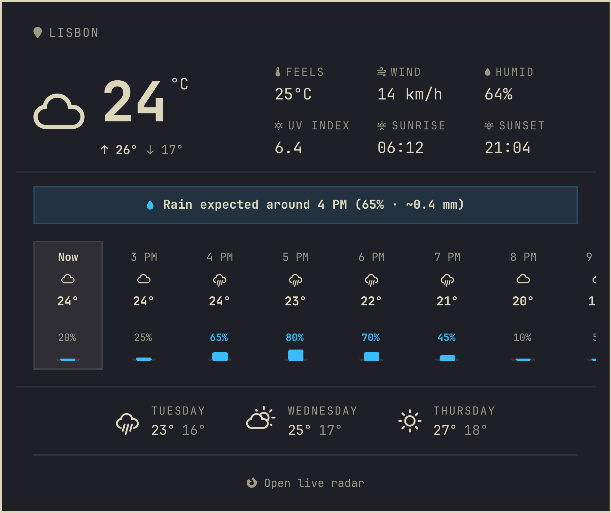
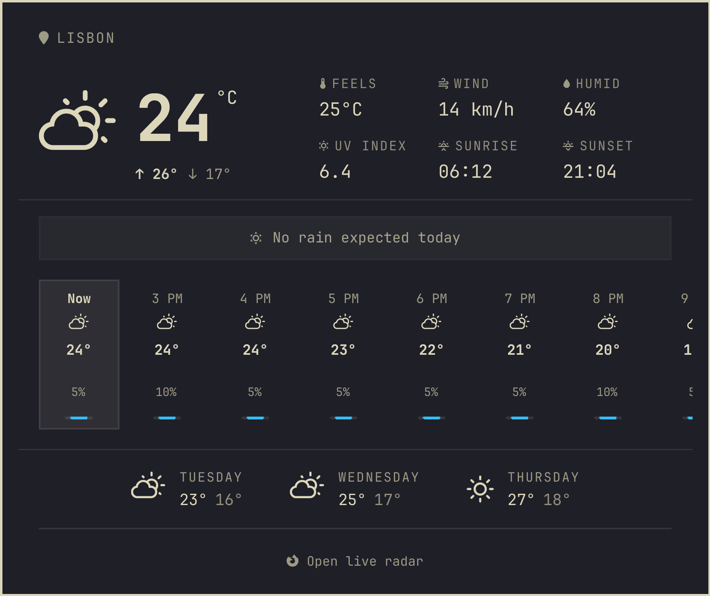
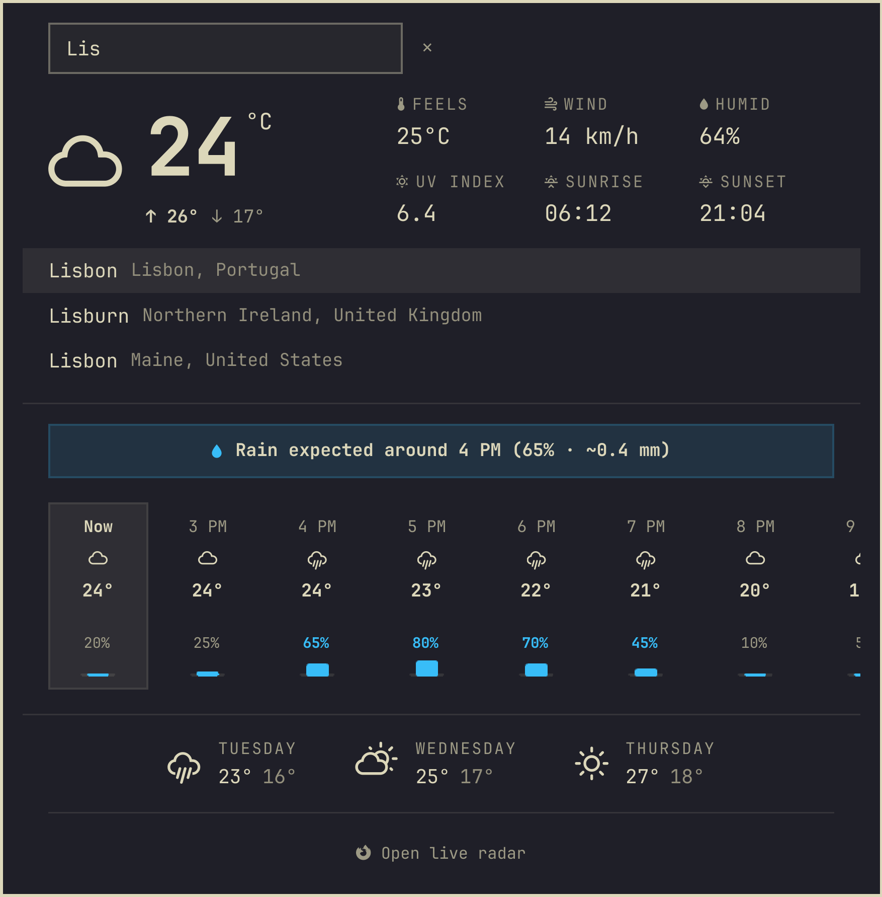
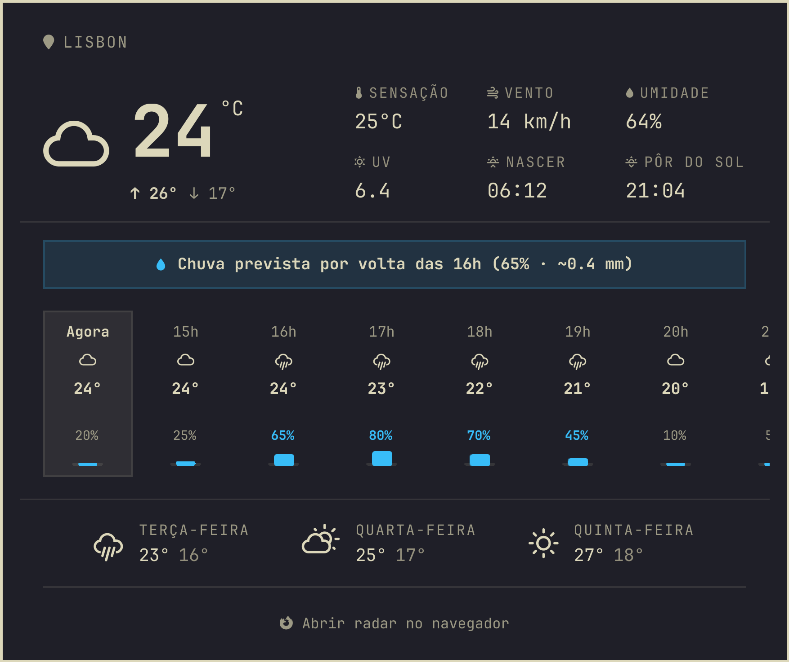

# Weather Plus for Omarchy

A richer, still lightweight weather widget for the [Omarchy](https://omarchy.org) bar:
a rain summary, an hourly strip with rain chances, UV index, sunrise and sunset, and a
link to a live radar. It answers the question you open a weather widget for: *will it
rain, when, and how much?*

Weather Plus is built on Omarchy's stock weather widget (`omarchy.weather`, MIT) and keeps
its look, its location search and its keyboard behavior.

<p align="center"></p>

## What you get

- **Rain summary banner**: one line that says it all, such as *Rain right now (72%)*,
  *Rain expected around 4 PM (65% · ~0.4 mm)* or *No rain expected today*.
- **Hourly strip with rain-chance bars** for the next 24 hours. Scroll it sideways with the
  mouse wheel or touchpad, or drag it.
- **Today's high and low** under the current temperature.
- **Stats grid**: feels-like, wind, humidity, UV index, sunrise and sunset.
- **Three days ahead**, as in the stock widget.
- **Imminent-rain dot**: a small blue dot on the bar icon when rain is likely (60% or more)
  in the next couple of hours, with the rain summary as its tooltip. No need to open the
  popup.
- **Open live radar**: opens [RainViewer](https://www.rainviewer.com/) at your coordinates in
  your browser.
- **Your language and units**: strings follow the language picked in Omarchy's setup
  (English, Portuguese, Spanish, French, German and Italian are complete; the other languages
  Omarchy ships get the stock widget's labels, with the newer lines in English). Hours, °C/°F and km/h or mph follow your locale and the place.
- **Location search**: click the place name (top left) to search for a city, as in the
  stock widget. Empty means "detect it for me".

<p align="center">
  
  
  
</p>
<p align="center"></p>

*(Screenshots are rendered from mock data by the dev harness, see
[Development](#development).)*

### Light by design

Weather widgets that embed map tiles can stall a desktop shell: loading dozens of remote
images blocks the UI. Weather Plus never downloads images. A refresh is two small JSON
requests, to [Open-Meteo](https://open-meteo.com/) and [wttr.in](https://wttr.in/) (free, no
API key), every 15 minutes, and the radar opens in your browser instead of inside the shell. The bar icon is a
single glyph plus a dot.

## Install

```bash
omarchy plugin add https://github.com/gusthanks/omarchy-weather.git --enable
omarchy restart shell
```

Weather Plus replaces the stock weather widget: use **one or the other**, not both. If the
stock one is in your bar, swap it in `~/.config/omarchy/shell.json`:

```diff
-        { "id": "omarchy.weather" },
+        { "id": "gusthx.weather" },
```

Update with `omarchy plugin update gusthx.weather --yes`, then `omarchy restart shell`.

## Use

| On the bar icon | Does |
|---|---|
| Left click | Open or close the popup |
| Middle click | Refresh now |
| Right click | Send the current weather as a notification (`omarchy-weather-status`) |

In the popup, <kbd>Enter</kbd> starts a location search, <kbd>↑</kbd>/<kbd>↓</kbd> pick a
suggestion, <kbd>Esc</kbd> cancels or closes, and <kbd>Tab</kbd> moves to the next bar panel.

From a keybinding or script:

```bash
omarchy-shell gusthx.weather toggle   # also: open, close, edit (jump into the search)
```

## Configuration

- **Location**: click the place name in the popup, or use Omarchy's helper:
  `omarchy-weather-location --set "Lisbon" 38.72,-9.14` and `omarchy-weather-location --clear`
  (back to automatic). Both write `~/.local/state/omarchy/settings/weather.json`, the file
  the stock widget uses too, so the two always agree.
- **Units and refresh**: optional settings on the widget's entry in
  `~/.config/omarchy/shell.json`:

  ```json
  { "id": "gusthx.weather", "unit": "imperial", "refreshMinutes": 30 }
  ```

  `unit` is `metric` or `imperial` (default: chosen from your locale and the place's
  country). `refreshMinutes` defaults to 15, minimum 1.

## Privacy

Weather Plus has no account, no API key and no telemetry. It does not log anything.

What it **reads**: `~/.local/state/omarchy/settings/weather.json` (your saved location) and
the widget's own entry in `~/.config/omarchy/shell.json`. It **writes** your location only
when you pick one, through `omarchy-weather-location`.

What it **contacts**, all over HTTPS with `curl`:

| Host | When | What it sends |
|---|---|---|
| `api.open-meteo.com` | every refresh | the coordinates of the place |
| `wttr.in` | every refresh | the coordinates, or the place name when there are none (fills in the area and acts as a fallback) |
| `geo.omarchy.org` | only when no location is set | nothing but the request: it answers with the city it sees for your IP (Omarchy's own service, used by the stock widget too) |
| `geocoding-api.open-meteo.com` | only while you type in the location search | what you typed and your language |
| `www.rainviewer.com` | only when you click *Open live radar*, in your browser | the coordinates, in the link |

Right-clicking the icon runs Omarchy's `omarchy-weather-status`, which asks `wttr.in` for a
one-line status. As with any web request, each service sees your IP address.

## Development

Work in a clone of this repository, never in the installed copy under
`~/.config/omarchy/plugins/` (saving there hot-reloads your bar). `dev/run.sh` starts a
**separate** Quickshell instance with Omarchy's `Commons`/`Ui` libraries, this repo and
mock data from `dev/mock/`: it never touches the running shell, the network or your
location. Captures render offscreen, so nothing shows on screen.

```bash
dev/run.sh check     # compile every QML type, Panel.qml and BarWidget.qml included
dev/run.sh test      # Model.js and i18n catalog tests (node --test, no npm packages)
dev/run.sh docs      # docs/panel.png, panel-dry.png, panel-search.png, bar.png
dev/run.sh preview   # the popup content in a window, to play with
LANGUAGE=pt-BR dev/run.sh panel   # docs/panel-pt-BR.png
omarchy plugin validate .
```

Layout: `BarWidget.qml` (the bar icon, loads the panel), `Panel.qml` (fetching, location,
IPC and the popup window), `WeatherView.qml` (the popup's content, fed by `Panel.qml` or by
the harness mock), `Model.js` (pure parsing and formatting helpers), `RainDot.qml`,
`i18n/*.json` (strings, read through `Commons.Translations`), `dev/` (harness, mocks, tests,
deploy).

When everything is committed and tested, install it into your own bar once:

```bash
dev/deploy.sh   # validates, compiles, installs HEAD into the live plugin, restarts the shell once
```

If the live folder is a plain copy rather than a git checkout, `deploy.sh` first moves it to
`~/Work/backups/gusthx.weather.<timestamp>` and replaces it with a checkout of this repo.
See [AGENTS.md](AGENTS.md) for the rules AI agents (and humans) follow here.

## Credits

Based on Omarchy's stock weather widget. Forecast data by
[Open-Meteo](https://open-meteo.com/) (CC BY 4.0) and [wttr.in](https://wttr.in/), radar by
[RainViewer](https://www.rainviewer.com/).

## License

[MIT](LICENSE) © Gustavo Costa
