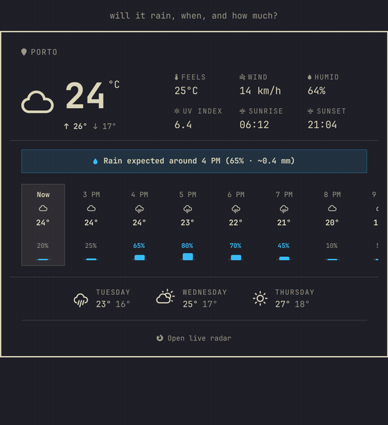
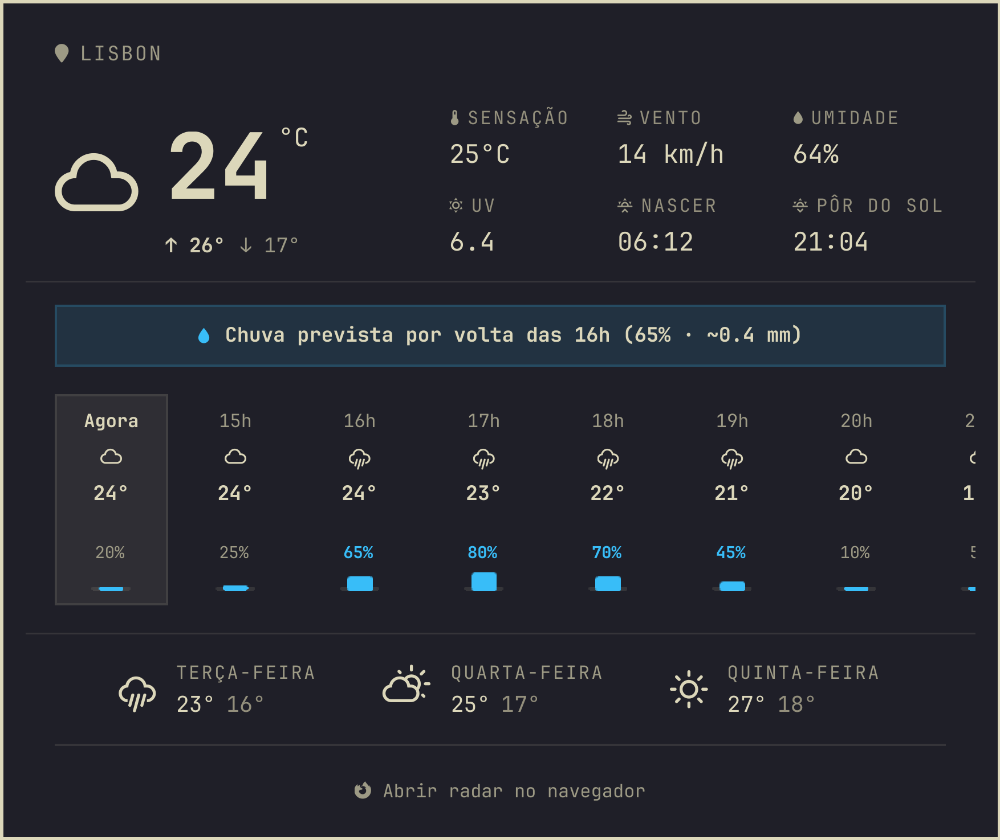
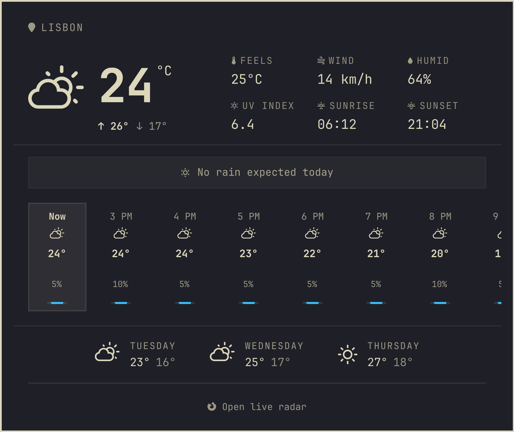
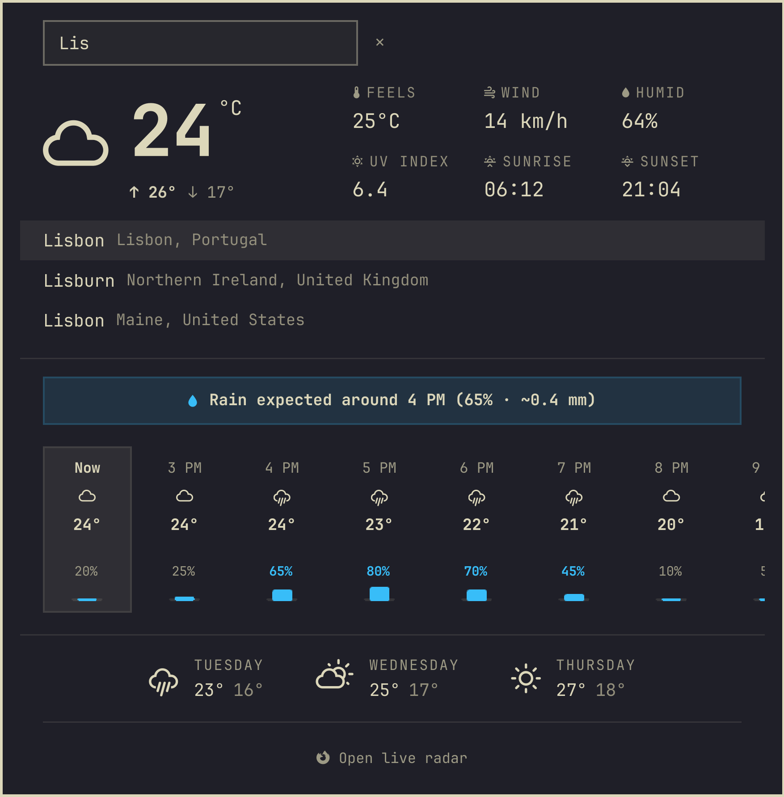
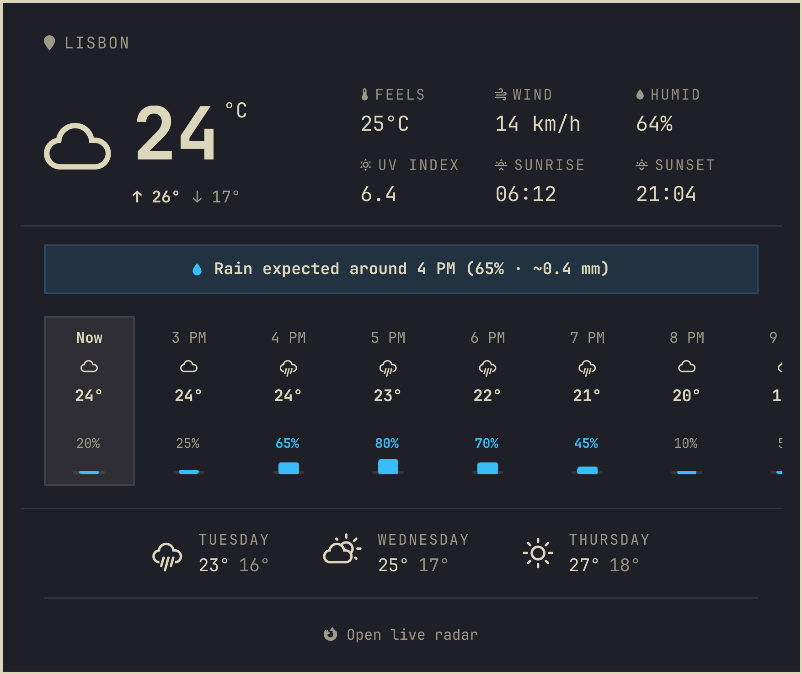

# Weather Plus para Omarchy

[English](README.md) · **Português (Brasil)**

Um widget de clima mais completo, e ainda leve, para a barra do [Omarchy](https://omarchy.org):
resumo de chuva, uma faixa por hora com a chance de chuva, índice UV, nascer e pôr do sol e
um link para um radar ao vivo. Ele responde à pergunta que faz você abrir um widget de
clima: *vai chover, quando e quanto?*

O Weather Plus parte do widget de clima padrão do Omarchy (`omarchy.weather`, MIT) e mantém
o visual, a busca de local e os atalhos de teclado dele.

<p align="center"></p>

## O que você ganha

<p align="center"></p>

- **Aviso de chuva**: uma linha que resume tudo, como *Chuva agora (72%)*,
  *Chuva prevista por volta das 16h (65% · ~0.4 mm)* ou *Sem previsão de chuva hoje*.
- **Faixa por hora com barras de chance de chuva** para as próximas 24 horas. Role para o
  lado com a roda do mouse ou o touchpad, ou arraste.
- **Máxima e mínima do dia** embaixo da temperatura atual.
- **Grade de dados**: sensação térmica, vento, umidade, índice UV, nascer e pôr do sol.
- **Três dias à frente**, como no widget padrão.
- **Ponto de chuva iminente**: um pontinho azul no ícone da barra quando a chuva é provável
  (60% ou mais) nas próximas duas horas, com o resumo de chuva como dica. Não precisa abrir
  o popup.
- **Abrir radar no navegador**: abre o [RainViewer](https://www.rainviewer.com/) nas suas
  coordenadas, no navegador.
- **Seu idioma e suas unidades**: os textos seguem o idioma escolhido na configuração do
  Omarchy (inglês, português, espanhol, francês, alemão e italiano estão completos; os outros
  idiomas do Omarchy recebem os rótulos do widget padrão, com as linhas novas em inglês).
  Horas, °C/°F e km/h ou mph seguem a sua localidade e o lugar.
- **Busca de local**: clique no nome do lugar (no canto superior esquerdo) para buscar uma
  cidade, como no widget padrão. Vazio quer dizer "descubra para mim".

<p align="center">
  
  
  
</p>
<p align="center"></p>

*(As capturas e o GIF são gerados com dados fictícios pelo ambiente de desenvolvimento, veja
[Desenvolvimento](#desenvolvimento).)*

### Leve de propósito

Widgets de clima que embutem mapas podem travar o shell da área de trabalho: carregar dezenas
de imagens remotas bloqueia a interface. O Weather Plus nunca baixa imagens. Cada
atualização são duas pequenas requisições JSON, para o [Open-Meteo](https://open-meteo.com/)
e o [wttr.in](https://wttr.in/) (gratuitos, sem chave de API), a cada 15 minutos, e o radar
abre no navegador em vez de dentro do shell. O ícone da barra é um único glifo mais um ponto.

## Instalação

```bash
omarchy plugin add https://github.com/gusthanks/omarchy-weather.git --enable
omarchy restart shell
```

O Weather Plus substitui o widget de clima padrão: use **um ou outro**, não os dois. Se o
padrão estiver na sua barra, troque em `~/.config/omarchy/shell.json`:

```diff
-        { "id": "omarchy.weather" },
+        { "id": "gusthx.weather" },
```

Para atualizar: `omarchy plugin update gusthx.weather --yes` e depois `omarchy restart shell`.

## Uso

| No ícone da barra | Faz |
|---|---|
| Clique esquerdo | Abre ou fecha o popup |
| Clique do meio | Atualiza agora |
| Clique direito | Manda o clima atual como notificação (`omarchy-weather-status`) |

No popup, <kbd>Enter</kbd> começa uma busca de local, <kbd>↑</kbd>/<kbd>↓</kbd> escolhem uma
sugestão, <kbd>Esc</kbd> cancela ou fecha e <kbd>Tab</kbd> passa para o próximo painel da barra.

Por um atalho de teclado ou script:

```bash
omarchy-shell gusthx.weather toggle   # também: open, close, edit (vai direto para a busca)
```

## Configuração

- **Local**: clique no nome do lugar no popup, ou use o utilitário do Omarchy:
  `omarchy-weather-location --set "Lisbon" 38.72,-9.14` e `omarchy-weather-location --clear`
  (volta ao automático). Os dois gravam em `~/.local/state/omarchy/settings/weather.json`, o
  mesmo arquivo que o widget padrão usa, então os dois sempre concordam.
- **Unidades e atualização**: ajustes opcionais na entrada do widget em
  `~/.config/omarchy/shell.json`:

  ```json
  { "id": "gusthx.weather", "unit": "imperial", "refreshMinutes": 30 }
  ```

  `unit` é `metric` ou `imperial` (padrão: escolhido pela sua localidade e pelo país do
  lugar). `refreshMinutes` tem padrão 15, mínimo 1.

## Privacidade

O Weather Plus não tem conta, chave de API nem telemetria. Ele não grava logs.

O que ele **lê**: `~/.local/state/omarchy/settings/weather.json` (o local salvo) e a entrada
do próprio widget em `~/.config/omarchy/shell.json`. Ele só **grava** o seu local quando você
escolhe um, por meio do `omarchy-weather-location`.

Com quem ele **fala**, sempre por HTTPS com `curl`:

| Servidor | Quando | O que envia |
|---|---|---|
| `api.open-meteo.com` | a cada atualização | as coordenadas do lugar |
| `wttr.in` | a cada atualização | as coordenadas, ou o nome do lugar quando não há coordenadas (completa a região e serve de reserva) |
| `geo.omarchy.org` | só quando não há local definido | nada além da requisição: responde com a cidade que vê pelo seu IP (serviço do próprio Omarchy, usado também pelo widget padrão) |
| `geocoding-api.open-meteo.com` | só enquanto você digita na busca de local | o que você digitou e o seu idioma |
| `www.rainviewer.com` | só quando você clica em *Abrir radar no navegador*, no navegador | as coordenadas, no link |

O clique direito no ícone roda o `omarchy-weather-status` do Omarchy, que pede ao `wttr.in`
um resumo de uma linha. Como em qualquer requisição na web, cada serviço vê o seu IP.

## Desenvolvimento

Trabalhe num clone deste repositório, nunca na cópia instalada em
`~/.config/omarchy/plugins/` (salvar ali recarrega a sua barra). O `dev/run.sh` sobe uma
instância **separada** do Quickshell com as bibliotecas `Commons`/`Ui` do Omarchy, este
repositório e os dados fictícios de `dev/mock/`: ele nunca mexe no shell em execução, na rede
nem no seu local. As capturas são renderizadas fora da tela, então nada aparece no monitor.

```bash
dev/run.sh check     # compila todos os tipos QML, inclusive Panel.qml e BarWidget.qml
dev/run.sh test      # testes do Model.js e dos catálogos i18n (node --test, sem pacotes npm)
dev/run.sh docs      # docs/panel.png, panel-dry.png, panel-search.png, bar.png, demo.gif
dev/run.sh gif       # só docs/demo.gif (demonstração roteirizada, precisa do ffmpeg)
dev/run.sh preview   # o conteúdo do popup numa janela, para brincar
LANGUAGE=pt-BR dev/run.sh panel   # docs/panel-pt-BR.png
omarchy plugin validate .
```

Estrutura: `BarWidget.qml` (o ícone da barra, carrega o painel), `Panel.qml` (busca de dados,
local, IPC e a janela do popup), `WeatherView.qml` (o conteúdo do popup, alimentado pelo
`Panel.qml` ou pelo mock do ambiente de desenvolvimento), `Model.js` (funções puras de leitura
e formatação), `RainDot.qml`, `i18n/*.json` (textos, lidos por `Commons.Translations`), `dev/`
(ambiente de desenvolvimento, mocks, testes, deploy).

Quando tudo estiver commitado e testado, instale na sua barra uma vez:

```bash
dev/deploy.sh   # valida, compila, instala o HEAD no plugin em uso e reinicia o shell uma vez
```

Se a pasta instalada for uma cópia simples e não um checkout git, o `deploy.sh` primeiro a
move para `~/Work/backups/gusthx.weather.<data-hora>` e a troca por um checkout deste
repositório. Veja o [AGENTS.md](AGENTS.md) (em inglês) para as regras que agentes de IA (e
pessoas) seguem aqui.

## Mudanças

Veja o [CHANGELOG.md](CHANGELOG.md) (em inglês).

## Créditos

Baseado no widget de clima padrão do Omarchy. Previsão do [Open-Meteo](https://open-meteo.com/)
(CC BY 4.0) e do [wttr.in](https://wttr.in/), radar do [RainViewer](https://www.rainviewer.com/).

## Licença

MIT. Veja a [LICENSE](LICENSE). Copyright (c) 2026 Gustavo Costa (gusthx); as partes que vêm
do widget de clima padrão do Omarchy são Copyright (c) David Heinemeier Hansson.
